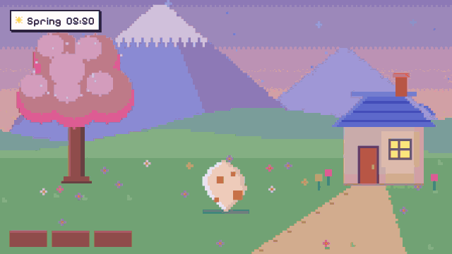

# Clawd Days

A pixel-art virtual pet game starring Clawd, playable in any browser. One HTML file, no build step, no dependencies.

**Play:** open `index.html`, or serve the folder with any static server.

▶ **[Watch the 30-second trailer with sound](https://aliciawque.github.io/clawd-days/promo/clawd-days-promo.mp4)** ([file](promo/clawd-days-promo.mp4)). Every frame is drawn by the game's own code, and the music is the game's own synth.

## What's in it

- **Raise Clawd** from a mystery egg through Baby and Kid to one of four final forms, decided by how you raise him (study, play, affection, or balance).
- **Four needs** — food, energy, mood, clean. Clawd never dies; neglect only makes him sick.
- **Five places** — Home, Garden, School, Funfair and Lake. Each has its own scenery, food specialties and animal visitors.
- **Day and night, four seasons** — a game hour is 10 real seconds, a season lasts 3 game days. Sakura, sunflowers and fireflies, red leaves, snow; rain and snowfall come and go.
- **19 foods** — everyday snacks, place specialties and one limited food per season. Clawd has a secret favorite.
- **8 animal friends** — each appears at a certain place, hour, season or weather. Befriend one and it follows Clawd around with a passive perk.
- **Things to do in every place** — sparkles mark what you can tap:
  - *Garden*: plant seasonal seeds in three plots, water them, harvest for coins (crops keep growing while you are away); shake the tree.
  - *Home*: read from the bookshelf, tap the bed to sleep, show off capsule toys.
  - *School*: the Daily Word (one five-letter word per real day), Clawd Dash (jump the hurdles), and a ball to kick at the goal.
  - *Funfair*: ride the Ferris wheel, go down the slide, and turn the capsule machine for 12 collectible toys.
  - *Lake*: fish from the dock (11 catches that depend on season, hour and weather) and draw a daily fortune at the torii that boosts coins.
- **Four mini-games** — Memory Tokens, Star Catch, Clawd Dash and the Daily Word.
- **Music and sound** — a procedural chiptune theme for every place (softer at night, a lullaby while Clawd sleeps), rain ambience, and effects for every interaction. All synthesized with Web Audio; no audio files. Volume and on/off live under the ♪ button.
- **Reasons to come back** — daily gift streak, three daily quests, welcome-back gifts, shooting stars, golden bugs, 49 trophies, hats, and a journal to fill.

Progress saves automatically to the browser's localStorage.

## Note

This is an unofficial fan project. Clawd is the mascot of Anthropic's Claude Code; the sprites here are hand-drawn for this game and it is not affiliated with or endorsed by Anthropic.
